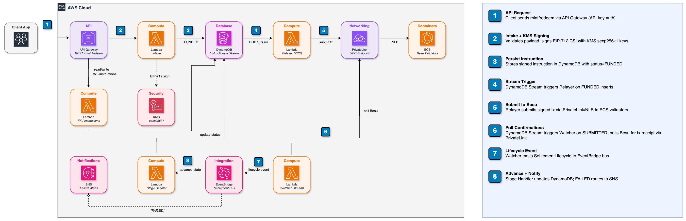

# Cross-Border Tokenized Deposits Settlement

> This sample is part of the
> [AWS Digital Asset Samples](https://aws-samples.github.io/aws-digital-asset-samples/)
> collection.

A reference sample that demonstrates how two branches of the same bank can settle cross-border payments in seconds instead of days, using tokenized deposits on a private blockchain. 

Bank ABC Canada (CA) and Bank ABC Mexico (MX) share a private Besu network. CA locks CAD in a collateral account, mints tokenized CAD (tCAD) on-chain, and the system auto-transfers it to MX. MX then redeems (burns) the tokens; the FX rate is captured at redemption and the equivalent MXN payout is tracked off-chain through to completion.

## Contents

- [Solution Architecture](#solution-architecture) — the big picture
- [Token Lifecycle](#token-lifecycle) — how one payment flows through the system
- [How It Works](#how-it-works) — step-by-step detail of each stage
- [Key Management](#key-management-all-kms) — the three KMS signing roles
- [API Endpoints](#api-endpoints) — REST surface and idempotency
- [Security](#security) — isolation, key custody, encryption
- [Directory Structure](#directory-structure) — where the code lives
- [Deployment](#deployment) — automated and manual paths
- [Limitations & Known Gaps](#limitations--known-gaps) — what's deferred for this sample

## Solution Architecture



## Token Lifecycle

Start here for the mental model. A single payment (e.g., 100 CAD from CA to MX) creates multiple on-chain instructions that chain automatically — [How It Works](#how-it-works) below walks through each step in detail.

```
┌──────────────────────────────────────────────────────────────────────────┐
│  1. POST /mint         CA operator initiates                             │
│     → FUNDED           Intake Lambda signs CSI with CA's KMS key         │
│     → SUBMITTED        Relayer picks up from DDB Streams, submits to Besu│
│     → MINTED           Watcher confirms executed(id) == true on-chain    │
│                                                                          │
│  2. Auto-triggered     Stage handler sees MINTED, creates transfer       │
│     → FUNDED           New BURN_AND_MINT instruction (CA wallet → MX)    │
│     → SUBMITTED        Relayer submits transfer tx                       │
│     → TRANSFERRED      Watcher confirms, MX wallet now has tokens        │
│                                                                          │
│  3. POST /redeem       MX operator initiates                             │
│     → FUNDED           Intake Lambda signs CSI with MX's KMS key         │
│     → SUBMITTED        Relayer submits burn tx                           │
│     → BURNED           Watcher confirms burn; MXN posting → POSTED       │
└──────────────────────────────────────────────────────────────────────────┘
```

Any step can → FAILED if the on-chain tx reverts or times out.

## How It Works

The stages below expand each phase of the lifecycle diagram above.

### 1. CAD Locking (off-chain)

Before minting, Bank ABC Canada moves the equivalent CAD into a designated collateral account in their core banking system. This is a banking pre-condition — the blockchain never sees CAD. It only sees the **authorization to mint**, signed by CA's KMS key, which implicitly attests: "the backing CAD is locked."

### 2. Minting tCAD (on-chain)

1. CA operator calls `POST /mint` (amount, token address, CA wallet)
2. Intake Lambda builds a Canonical Settlement Instruction (CSI), signs it via CA's KMS key (EIP-712), writes to DynamoDB → status: `FUNDED`
3. Relayer Lambda (DDB Streams trigger) submits the signed CSI to the `SettlementConsumer` contract by calling `settle()`
4. On-chain: contract verifies the EIP-712 signature against the `KeyRegistry`, checks expiry/chain/uniqueness, calls `Token.mint(caWallet, amount)`
5. Watcher Lambda (DDB Streams trigger — fires on `SUBMITTED` status change) polls `executed(instructionId)` in a tight loop (~2s intervals) → when `true`, updates status to `MINTED`, emits EventBridge event

### 3. Auto-transfer CA → MX (on-chain, no human intervention)

1. Stage Handler Lambda receives the `MINTED` event
2. Automatically creates a new CSI with `intent: BURN_AND_MINT` (from CA wallet → MX wallet), signs with CA's KMS key → status: `FUNDED`
3. Relayer submits → on-chain: burns from CA, mints to MX (atomic)
4. Watcher confirms → status: `TRANSFERRED`

### 4. Redemption / Burn (on-chain + off-chain)

1. MX operator calls `POST /redeem` (amount, MX wallet; optionally a beneficiary and an idempotency key/reference)
2. Intake Lambda resolves the current CAD→MXN rate, computes the MXN amount, and **snapshots the rate** (`fxRate`, `fxSource`, `fxTimestamp`, `mxnAmount`) onto the instruction. It also creates a **redemption posting record** (`status: PENDING`) for the off-chain MXN disbursement, then signs a `BURN_ONLY` CSI with MX's KMS key → status: `FUNDED`. If no FX rate is available, the redemption is rejected before any state is written.
3. Relayer submits → on-chain: `Token.burn(mxWallet, amount)` — tokens destroyed
4. Watcher confirms → status: `BURNED`. The stage handler then posts the (simulated) MXN disbursement, flipping the redemption posting `PENDING → POSTED`.
5. MX disburses the equivalent MXN through traditional banking rails at the rate captured in step 2 (recorded on both the instruction and the posting record). The actual MXN payout is off-chain; in this sample the disbursement is simulated.

### 5. Collateral Management

When CA mints tCAD, the system records a **collateral lock** (`COLLATERAL` record, status: `LOCKED`) representing the real CAD held in the segregated account. When MX redeems (burns) tCAD, the stage handler releases collateral using FIFO ordering (oldest locks first). Partial release is supported — if the burn is smaller than a single lock, only the needed portion is released and the remainder stays locked.

### 6. Reconciliation

After a burn is confirmed on-chain, the stage handler writes a **reconciliation record** that proves the on-chain burn matches off-chain obligations:

- **Burn amount** (on-chain) vs **collateral released** (off-chain CAD) vs **MXN posted** (off-chain payout)
- Status: `MATCHED` (all amounts align) or `MISMATCH` (requires investigation)

Additional reconciliation data:

- **On-chain:** `executed(instructionId)` = cryptographic proof of settlement
- **Off-chain:** DynamoDB audit trail (`AUDIT#timestamp#status`) = full history of every state transition, including the FX snapshot and the MXN posting `PENDING → POSTED`
- **API:** `GET /instructions/{id}` = returns instruction + collateral + redemption posting + reconciliation record + audit trail

## Key Management (all KMS)

Every signing key lives in AWS KMS (ECC_SECG_P256K1). Private keys never leave the HSM.

| Role | KMS Alias | Purpose |
|------|-----------|---------|
| **CA Signer** | `tokenized-cash/ca-signer` | Signs mint + transfer instructions (EIP-712) |
| **MX Signer** | `tokenized-cash/mx-signer` | Signs redeem/burn instructions (EIP-712) |
| **Relayer** | `tokenized-cash/relayer-signer` | Signs `settle()` transactions submitted to Besu |

CA and MX signers are registered in the on-chain `KeyRegistry` — the `SettlementConsumer` contract verifies their EIP-712 signatures before executing. The relayer is allowlisted in `SettlementConsumer` as the only address permitted to call `settle()`.

## API Endpoints

| Method | Path | Description |
|--------|------|-------------|
| POST | `/mint` | Create mint instruction (CA-signed) |
| POST | `/redeem` | Create burn instruction (MX-signed); snapshots FX rate + creates MXN payout posting |
| GET | `/instructions` | List all instructions (filter: `?status=MINTED`) |
| GET | `/instructions/{id}` | Single instruction + audit trail, FX snapshot, and MXN redemption posting |
| GET | `/fx/rate` | Current CAD→MXN rate (auto-fetched from Bank of Canada) |
| POST | `/fx/rate` | Manual rate override |
| POST | `/fx/convert` | Convert CAD amount to MXN |
| GET | `/chain/token` | Token name, symbol, totalSupply |
| GET | `/chain/balance` | Balance for address (`?address=0x...`) |
| GET | `/chain/executed` | Check if instruction executed on-chain |
| GET | `/chain/block` | Current block number |

All endpoints require `x-api-key` header.

**Idempotency:** `/mint` and `/redeem` accept an optional `Idempotency-Key` header (or `idempotencyKey` in the body). When an idempotency key — or a `reference` — is supplied, a repeat request is deduplicated and returns the original instruction (`idempotentReplay: true`) instead of creating a new one. With no identifier, each request is treated as unique.

## Directory Structure

```
sample-tokenized-deposits-settlement/
├── besu-private-chain/         # Besu IBFT blueprint (AWS Node Runners CDK)
├── tokenized-cash/             # Main application
│   ├── contracts/              # Solidity: SettlementConsumer, Token (tCAD), KeyRegistry
│   ├── lib/                    # Shared: csi.ts (EIP-712), kmsSigner.ts, dynamo.ts
│   ├── lambdas/
│   │   ├── intake/             # POST /mint, /redeem → KMS-sign → DynamoDB
│   │   ├── relayer/            # DDB Streams → submit settle() to Besu (VPC-attached)
│   │   ├── watcher/            # DDB Streams → poll executed(id) → emit EventBridge (VPC-attached)
│   │   ├── stage-handlers/     # EventBridge → create next instruction in chain
│   │   ├── instructions/       # GET /instructions, /instructions/:id (history + status)
│   │   ├── chain-reader/       # GET /chain/* → proxy on-chain reads (VPC-attached)
│   │   └── fx/                 # FX rate CRUD + Bank of Canada auto-fetch
│   ├── infra/                  # CDK stack (all infrastructure)
│   ├── web-ui/                 # React dashboard (Vite + Tailwind)
│   └── scripts/                # Contract deploy, key generation, e2e test
└── README.md
```

## Deployment

### Prerequisites

These apply to both the automated and manual paths:

- AWS account with credentials configured (AWS CLI — used throughout for ECR, CloudFormation, KMS, etc.)
- AWS account with CDK bootstrapped (`npx cdk bootstrap`) — the automated `deploy.sh` checks for this and bootstraps if missing; required as a manual step only for the manual deployment below
- Docker or finch (to pull and push the Besu `hyperledger/besu:24.7.0` image to ECR)
- Foundry installed locally (contract compilation) — the automated `deploy.sh` checks for this and installs it (via `foundryup`) if missing; required as a manual step only for the manual deployment below
- Node.js 20+

### Automated (recommended)

```bash
./deploy.sh --yes        # non-interactive
```

The script runs all 6 steps below end-to-end: KMS bootstrap → key generation → Besu fleet → contract deploy → CDK redeploy with full context → E2E test. It also generates `web-ui/.env` automatically.

### Teardown

```bash
./cleanup.sh --yes    # destroys all stacks, S3 buckets, log groups, ECR repo
```

Removes everything in order: application stack → Besu fleet → Besu infra → orphaned S3/logs/ECR → local state files.

### Launch Dashboard

After deployment completes, the script generates `web-ui/.env` with all configuration. Start the UI:

```bash
cd tokenized-cash/web-ui
npm install
npm run dev
# Open http://localhost:5173
```

---

<details>
<summary><strong>Manual Deployment Steps (reference)</strong></summary>

### 1. Bootstrap KMS Keys (CDK — first pass)

The application stack creates three KMS signing keys (CA, MX, relayer). On a fresh deployment, run CDK once without on-chain context to provision these keys:

```bash
cd tokenized-cash
npm install
rm -f cdk.context.json
npx cdk deploy --require-approval never
```

> **Note:** This deploy creates KMS keys, DynamoDB, and Lambdas — but Lambdas won't work yet because the on-chain context (contract addresses, Besu RPC) is missing. That's expected; we'll redeploy with full context in step 5.

Save the three KMS Key IDs from the CDK outputs:
- `KMS_KEY_ID_CA`
- `KMS_KEY_ID_MX`
- `KMS_KEY_ID_RELAYER`

---

### 2. Generate Deployer Key + Derive Relayer Address

The deployer is an ephemeral key for one-time contract deployment. The relayer address is derived from the KMS key created in step 1.

```bash
cd tokenized-cash
KMS_KEY_ID_RELAYER=<from-step-1> npx ts-node scripts/generate-deployer-relayer.ts
```

This outputs two addresses:
- **Deployer** — random key, signs deploy transactions. Used once, then discarded.
- **Relayer** — KMS-backed (`tokenized-cash/relayer-signer`), signs `settle()` transactions. Private key never leaves the HSM.

---

### 3. Deploy Besu Network

The Besu blueprint uses a two-phase deploy with validator key generation in between. Gas is free on this private chain (`gasPrice: 0`), so no account prefunding is needed.

```bash
cd besu-private-chain
npm install
cp .env-sample .env
# Edit .env: AWS_ACCOUNT_ID, AWS_REGION (us-west-2), SHARD (any number)
source .env
```

**Push Besu image to ECR:**
```bash
docker pull --platform linux/arm64 hyperledger/besu:24.7.0
docker tag hyperledger/besu:24.7.0 $AWS_ACCOUNT_ID.dkr.ecr.$AWS_REGION.amazonaws.com/besu:latest
aws ecr get-login-password --region $AWS_REGION | docker login --username AWS --password-stdin $AWS_ACCOUNT_ID.dkr.ecr.$AWS_REGION.amazonaws.com
aws ecr create-repository --repository-name besu 2>/dev/null || true
docker push $AWS_ACCOUNT_ID.dkr.ecr.$AWS_REGION.amazonaws.com/besu:latest
```

**First deploy** (infrastructure, 0 validators):
```bash
FIRST_DEPLOY=1 npx tsc && npx cdk deploy dev-noderunners-${USER}-PrivateChainValidatorFleet --require-approval never
```

**Generate validator keys:**
```bash
./scripts/generate-keys.sh
```

**Second deploy** (provisions 4 validators):
```bash
unset FIRST_DEPLOY && npx tsc && npx cdk deploy dev-noderunners-${USER}-PrivateChainValidatorFleet --require-approval never
```

Chain is running when validators signal healthy (~3-5 min). Note the internal NLB DNS:
```bash
aws elbv2 describe-load-balancers --region $AWS_REGION \
  --query "LoadBalancers[?Scheme=='internal'].[DNSName]" --output text
```

---

### 4. Deploy Contracts

**Compile** (EVM target `london` — no PUSH0 on IBFT):
```bash
cd tokenized-cash/contracts
forge build --via-ir --optimizer-runs 200
```

**Deploy** via SSM (NLB is internal, so transactions are broadcast through a validator):
```bash
cd tokenized-cash
DEPLOYER_KEY=0x... \
KMS_KEY_ID_CA=<from-step-1> \
KMS_KEY_ID_MX=<from-step-1> \
KMS_KEY_ID_RELAYER=<from-step-1> \
npx ts-node scripts/deploy-contracts-via-ssm.ts
```

This derives all three Ethereum addresses from KMS, then deploys KeyRegistry (with CA+MX signers), SettlementConsumer (with relayer allowlisted), and Token (tCAD).

Save the output contract addresses (`settlementContract`, `tokenAddress`).

---

### 5. Redeploy Application Stack (CDK — full context)

Now redeploy CDK with all the on-chain context gathered from previous steps:

```bash
cd tokenized-cash
rm -f cdk.context.json
npx cdk deploy --require-approval never \
  -c besuVpcId=<besu-vpc-id-from-step-3> \
  -c besuRpcUrl=http://<nlb-dns-from-step-3>:80 \
  -c settlementContract=<consumer-address-from-step-4> \
  -c tokenAddress=<token-address-from-step-4> \
  -c mxWallet=<mx-signer-eth-address>
```

Get the API key:
```bash
aws apigateway get-api-keys --region $AWS_REGION --include-values \
  --query "items[?name=='tokenized-cash-pilot-key'].value" --output text
```

---

### 6. Verify E2E

```bash
API_URL=https://xxx.execute-api.us-west-2.amazonaws.com/v1 \
API_KEY=<api-key> \
CA_WALLET=<ca-signer-eth-address> \
MX_WALLET=<mx-signer-eth-address> \
TOKEN_ADDR=<token-address> \
npx ts-node scripts/e2e-test.ts
```

The test exercises the full lifecycle: mint → on-chain confirm → auto-transfer CA→MX → redeem/burn → on-chain confirm.

---

### 7. Launch Dashboard (manual .env)

If you deployed manually (not via `deploy.sh`), create `web-ui/.env`:
```
VITE_API_BASE_URL=https://xxx.execute-api.us-west-2.amazonaws.com/v1
VITE_API_KEY=<your-api-key>
VITE_CA_WALLET=<ca-wallet-address>
VITE_MX_WALLET=<mx-wallet-address>
VITE_TOKEN_ADDRESS=<token-address>
VITE_SETTLEMENT_CONTRACT=<settlement-consumer-address>
```

```bash
cd tokenized-cash/web-ui
npm install
npm run dev
```

</details>

## Security

- All infrastructure in private VPC — no public internet egress
- All three signing keys (CA, MX, relayer) are KMS `ECC_SECG_P256K1` with `SIGN_VERIFY` — private keys never leave the HSM
- No secrets in code, environment variables, or Secrets Manager — signing is always via KMS API
- API Gateway requires API key on all endpoints
- DynamoDB encrypted at rest
- VPC-attached Lambdas communicate via VPC endpoints (DynamoDB, EventBridge, KMS)

## Limitations & Known Gaps

This is a reference sample. The following are intentionally deferred and would be required before production:

- **Collateral cap check.** A collateral-lock record is created on mint and released on burn (FIFO, partial release supported), but there is no pre-mint balance/cap validation against an external core-banking system.
- **API authentication.** Endpoints are protected by an API Gateway API key — a throttling/metering mechanism, not strong authentication — and the calling `entity` is asserted in the request body. Production needs a real authorizer (IAM / Cognito / Lambda authorizer) and per-entity authorization.
- **Key & registry governance.** The on-chain admin is the one-time deployer key; if discarded, signer/relayer/minter rotation is not possible. Production should assign admin to a retained KMS key or multisig.
- **Signing without a Nitro Enclave.** Lambdas sign directly via the KMS `Sign` API. Private keys are still generated in and never leave the KMS HSM, so there is no plaintext key exposure. A Nitro Enclave would add *attestation-gated signing* — KMS will only sign for an enclave running a known-good image, defending against a compromised Lambda forging transactions. That assurance costs an always-on enclave EC2 instance (vs. pay-per-invoke Lambda), a custom enclave image to build/sign/version, VSOCK plumbing, attestation-conditioned key policies, and a harder deploy/debug loop — deferred for this sample.
- **Failure handling.** A submitted instruction that never executes is not aged to `FAILED` by the watcher, and a relayer retry after an already-executed transaction can mis-mark a settled instruction as `FAILED`.
- **MXN disbursement is simulated.** The redemption posting `PENDING → POSTED` models the off-chain payout; there is no real banking-rail integration, and the burn currently precedes the (simulated) payout.
- **FX precision.** Rates are stored as integers scaled by 1000 (3 decimal places) and CAD→MXN conversion floors.
